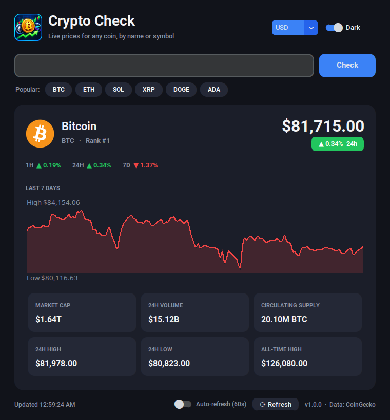

# Crypto Check

A desktop crypto price checker for Linux and Windows, built with Python and [CustomTkinter](https://github.com/TomSchimansky/CustomTkinter).
Type any coin's **name** (`Bitcoin`, `dogecoin`) or **ticker symbol** (`BTC`, `ETH`, `PEPE`) and get its live price.



Prices come from the free [CoinGecko API](https://www.coingecko.com/en/api), so you don't need an API key or an account.

## Features

- **Search by name or ticker.** Exact matches come first, and when several coins share a ticker, the biggest one wins.
- **"Not it? Try:" suggestions.** If your search matched other coins too, you can switch to one with a single click.
- **Live price** with a colored 24h change badge, plus 1h / 24h / 7d % changes.
- **7-day price chart.** Hover over it to see the price at any hour.
- **Key stats:** market cap, 24h volume, circulating supply, 24h high/low and all-time high.
- **10 currencies:** USD, EUR, GBP, JPY, CAD, AUD, CHF, INR, and BTC/ETH.
- **Popular picks:** one-click buttons for BTC, ETH, SOL, XRP, DOGE and ADA.
- **Dark and light mode**, plus optional **auto-refresh** every 60 seconds.

## Install

Download the files from the [latest release](https://github.com/g0d1k/crypto-check/releases/latest).

### Windows

**Installer:** download `CryptoCheck-Setup-<version>.exe` and run it. You don't need admin rights, and it adds Crypto Check to the Start menu.

**Portable:** download `CryptoCheck-<version>-windows-portable.zip`, unzip it, and run `CryptoCheck.exe`.

> Windows may show a **"Windows protected your PC"** (SmartScreen) message, because the app isn't code-signed.
> Click **More info → Run anyway**.

### Linux (any distro)

**AppImage:** a single file that runs on most distros without installing anything.

```bash
chmod +x CryptoCheck-*-x86_64.AppImage
./CryptoCheck-*-x86_64.AppImage
```

If it says *"Cannot mount AppImage, please check your FUSE setup"*, either install FUSE
(`sudo apt install libfuse2t64` on Ubuntu 24.04+, `libfuse2` on older versions) or run it with
`./CryptoCheck-*-x86_64.AppImage --appimage-extract-and-run`.

### With pip / pipx (Linux, Windows, macOS)

```bash
pipx install crypto-check
crypto-check
```

`pipx` puts the app in its own isolated environment. `pip install crypto-check` works too.
On Linux you need Tkinter: `sudo apt install python3-tk` (Debian/Ubuntu), `sudo dnf install python3-tkinter` (Fedora), or `sudo pacman -S tk` (Arch).

## Run from source

```bash
git clone https://github.com/g0d1k/crypto-check.git
cd crypto-check
python3 -m venv .venv
source .venv/bin/activate        # Windows: .venv\Scripts\activate
pip install -r requirements.txt
python -m crypto_check
```

Requires Python 3.9 or newer.

## How to use

1. Type a coin name or ticker into the search box, e.g. `solana`, `XRP`, `shiba inu`.
2. Press **Enter** or click **Check**.
3. Use the dropdown in the top-right to change currency.
4. If the result isn't the coin you meant, pick one from the **"Not it? Try:"** row.

## Building the installers yourself

GitHub Actions builds everything automatically when you push a version tag (see [PUBLISHING.md](PUBLISHING.md)).
To build locally:

```bash
pip install . pyinstaller
pyinstaller packaging/pyinstaller/crypto_check.spec   # -> dist/CryptoCheck/
```

Then, depending on your OS:

- **Linux AppImage:** `bash packaging/appimage/build_appimage.sh` creates `dist/CryptoCheck-<version>-x86_64.AppImage`.
- **Windows installer:** install [Inno Setup](https://jrsoftware.org/isinfo.php), then run `iscc packaging\windows\installer.iss`.

The Windows build has to run on Windows, and the Linux build on Linux.

## Project structure

```
crypto-check/
├── crypto_check/            # The app (a Python package)
│   ├── app.py               #   CustomTkinter GUI: window, chart, stats, events
│   ├── crypto_api.py        #   CoinGecko API calls: search, market data, logos
│   ├── __init__.py          #   Version number lives here
│   ├── __main__.py          #   Lets you run `python -m crypto_check`
│   └── assets/              #   App icons
├── packaging/
│   ├── icon-source.png      # The original app icon artwork
│   ├── make_icon.py         # Builds every icon size from icon-source.png
│   ├── pyinstaller/         # Standalone executable recipe
│   ├── windows/             # Inno Setup installer script
│   ├── appimage/            # AppImage build script
│   └── linux/               # .desktop file, AppStream metainfo, icons
├── .github/workflows/       # Automated release builds
├── docs/screenshot.png
├── pyproject.toml           # Package metadata (used by pip / PyPI)
├── requirements.txt         # Dependencies, for running from source
├── PUBLISHING.md            # How to release and publish to app stores
└── LICENSE                  # MIT
```

## Notes

- **Rate limits:** CoinGecko's free API allows roughly 10–30 requests per minute. If you search very quickly, the app will show a "Rate limit hit" message. Wait a minute and try again.
- **Prices** are CoinGecko's aggregated market prices and may differ slightly from any single exchange.
- This app is for information only. It is not financial advice.

## License

[MIT](LICENSE)
